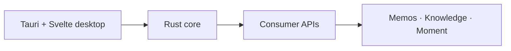

<div align="center">
  
  <h1>Vesper</h1>
  <p><strong>A personal operating console for the things that matter.</strong></p>
  <p>Content, infrastructure, daily tasks, and AI usage — brought together in one local-first desktop app.</p>
</div>

<p align="center">
  
</p>

Vesper is a focused desktop workspace backed by a Rust core. It combines a live personal dashboard
with content, planning, media, and publishing workflows. Release builds keep Vesper-owned credentials
in the operating-system store; debug builds use the local database.

It is designed to stay open throughout the day: glance at system health, capture an idea, review a
photo stream, continue a longer draft, or publish content without switching between unrelated tools.

## Everything in one place

- **Dashboard** — UGOS telemetry, weather, GitHub activity, Todo, and AI usage or balances
- **Memos** — write, search, pin, favorite, archive, and restore short-form notes
- **Moment** — browse and manage a personal photo stream with progressive images
- **Knowledge** — create and read long-form Markdown with a focused article experience
- **Newspaper** — the AIHOT AI daily on a calm paper surface
- **Music** — browse and play Spotify and QQ Music collections
- **Planning and spending** — manage Todo, habits, calendars, and local GBP expenses on the dashboard
- **Games** — view daily notes, pull history, and Steam activity on the dashboard
- **Terminals** — open a local shell or connect to permitted Tailscale devices over SSH

## Built around clear boundaries

- **Local first** — the desktop experience starts immediately, with Todo and spending records stored locally
- **One trusted core** — Rust owns commands, network access, content compilation, publication, and
  runtime behavior
- **Focused interfaces** — Svelte provides a calm, responsive view layer



The workspace is built with Tauri v2, Svelte 5, Rust, and a small shared UI package. Companion APIs
remain responsible for their own durable records and media.

> [!IMPORTANT]
> Vesper is a highly customized personal workspace built around one person's infrastructure,
> accounts, content conventions, and daily workflow. It is not an out-of-the-box general-purpose
> application. A fork needs compatible companion services such as Vesper and `my-knowledge`, plus
> its own credentials and optional dashboard integrations.

## Build from source

```sh
pnpm install
pnpm dev
pnpm check
pnpm test
```

Create a desktop installer with `pnpm build:desktop`.

## Documentation

- [Documentation index](docs/README.md)
- [Architecture](docs/ARCHITECTURE.md)
- [Dashboard integrations](docs/DASHBOARD.md)
- [Development and releases](docs/DEVELOPMENT.md)
- [Design system](docs/DESIGN.md)
- [Code style](docs/STYLEGUIDE.md)
